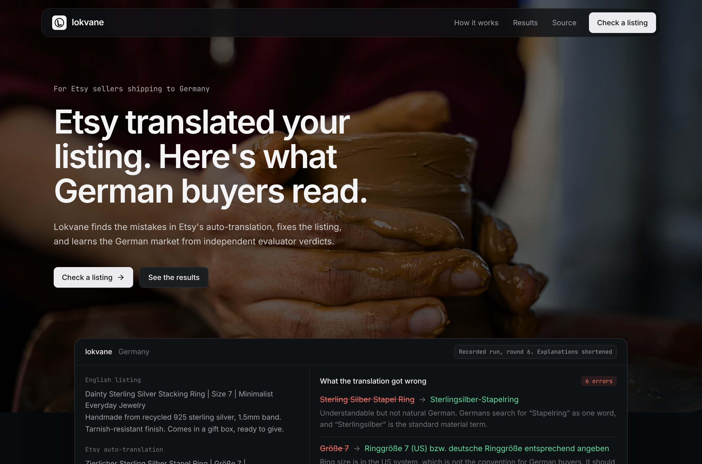
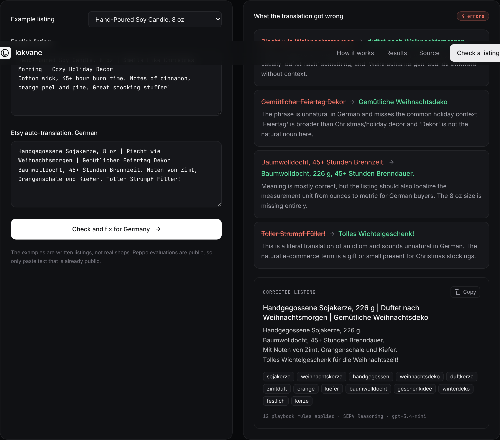
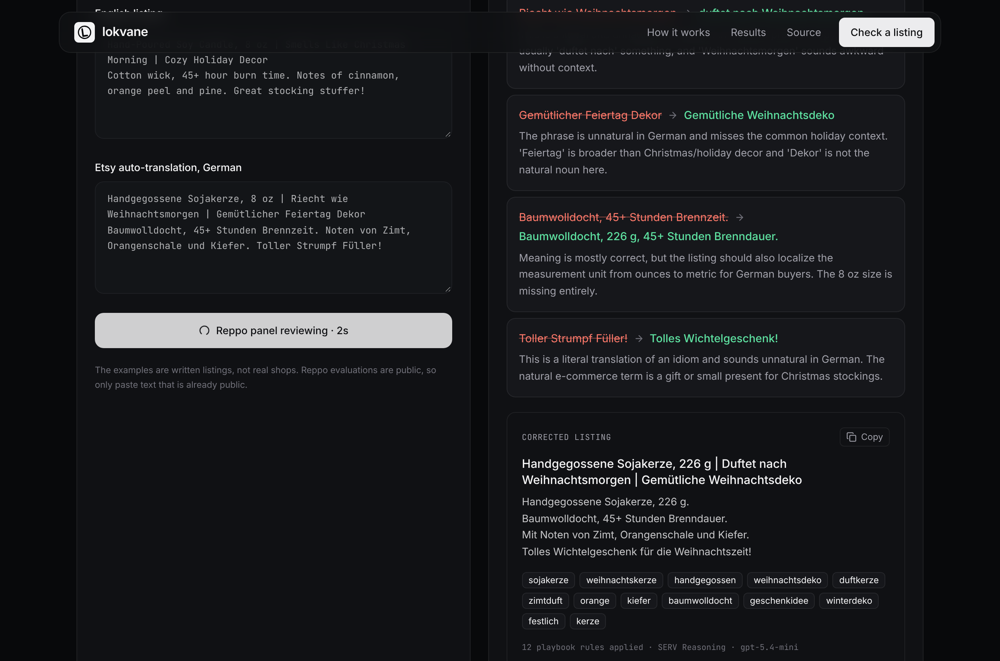
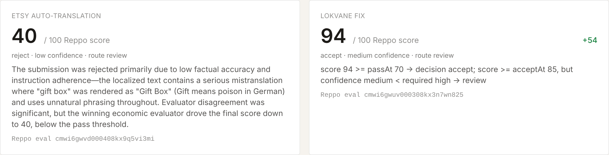
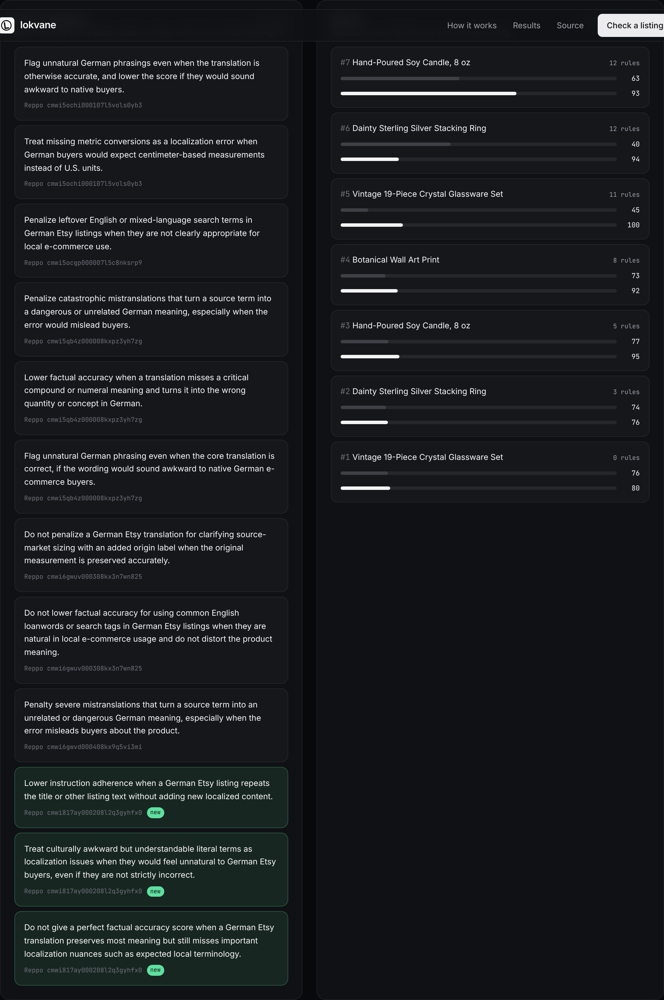

# Lokvane

Lokvane finds what Etsy's auto-translation got wrong in each market, fixes the listing, and learns that market's rules from independent Reppo verdicts. Each listing comes out better than the one before it.

**Live app:** https://lokvane.midelabs.xyz (product page) · https://lokvane.midelabs.xyz/check (the tool)
**Demo video:** _link added at submission_
**X post:** _link added at submission_
**Track:** Reppo (SERV Hackathon Edition 02 by OpenServ)

---

## The problem

Etsy automatically machine-translates every listing into the buyer's language ([Etsy Help](https://help.etsy.com/hc/articles/360000343048)). Sellers can't read most of those languages, so they can't check what buyers actually see. They report errors that change what is being sold:

- A vintage **19-piece** glassware set shown to buyers as a set **from the 19th century** ([Etsy Community](https://community.etsy.com/t5/Technical-Issues/the-automatic-translation-makes-typical-AI-hallucination/m-p/147084237)).
- Product names and shop names translated into unrelated words, and English titles replaced by translations ([Etsy Community](https://community.etsy.com/t5/Technical-Issues/Etsy-please-stop-using-AI/m-p/149053052)).
- English words that mean something else in the target language. In German, **"Gift" means poison**, so "Perfect Gift for Her" becomes "Perfect Poison for Her" ([Translated.com guide](https://translated.com/resources/marketplace-seller-translation-guide)).

Etsy's own guidance is that manual translations read more naturally and rank better in local search. Most small sellers can't afford a translator for every market they ship to, and a translator still won't tell them which local search terms buyers use.

Generic AI translation has the same weakness Etsy's does. It grades its own work, so nothing tells it when it's wrong, and it makes the same mistake on the next listing.

## The solution

Lokvane is a localization agent for marketplace sellers. Germany is the first market.

1. The seller pastes the English listing and Etsy's German auto-translation.
2. **SERV Reasoning** compares them and lists every error: what the machine wrote, why it misleads a German buyer, and the fix. It then writes a corrected German listing with local search tags.
3. **Reppo**, an independent evaluator panel, scores the auto-translation and the Lokvane fix side by side. Lokvane never scores itself.
4. Lokvane reads the evaluators' critiques and turns them into **playbook rules** for that market. Every rule records the Reppo eval ID that produced it.
5. The next listing is fixed with the updated playbook. The round history shows whether the scores went up.

The result is a per-market playbook built from outside judgment rather than self-assessment, and it improves with every listing.

## About

Lokvane is a solo build for SERV Hackathon Edition 02. It started on November 15, 2026, and everything in this repository was built during the hackathon: the SERV Reasoning fixing pipeline, the Reppo evaluation client, the learning loop, the web app, the production deployment, and the recorded proof run.

The name is a coined word. It hints at "locale" and has no ties to any existing product.

## Tracks

| Track | Why Lokvane fits |
|---|---|
| **Reppo track:** reliable agents that turn real-time feedback into measurable improvements | Every fix is scored by the Reppo Evaluation API. Reppo critiques become playbook rules. Scores are tracked per round and stored with Reppo eval IDs, so the improvement can be checked. |

SERV Reasoning, which the hackathon requires for every track, generates every fix and every playbook rule.

---

## Judging criteria

The hackathon judges three things: creativity, user readiness, and revenue potential. This section maps each one to evidence in this repo.

### Creativity

- **An agent that doesn't grade its own homework.** Most self-improving agents critique themselves. Lokvane learns only from an independent panel (Reppo), so its rules come from judgment outside the model that made the mistake.
- **Traceable learning.** Every playbook rule shows the Reppo eval ID that taught it ([proof/playbook-de.json](proof/playbook-de.json)). You can follow any rule back to the verdict and critique that created it.
- **A new use for evaluation.** Reppo is usually a gate that blocks bad output before it ships. Lokvane uses the verdict as training signal, so each evaluation makes the next listing better.

### User readiness

- **Live in production** at https://lokvane.midelabs.xyz, on a Dokploy server behind HTTPS.
- **One screen, one action.** Paste two texts and press one button. No account, no setup, no Etsy login.
- **Results a seller can act on.** Each error is shown as wrong phrase → corrected phrase with a one-line explanation in English, followed by a ready-to-paste German title, description and 13 tags.
- **Honest states.** The UI shows when the Reppo panel is reviewing (with elapsed time), failed evaluations, missing API keys, and a notice that Reppo evaluations are public.
- **Safe to leave open to the public.** Every endpoint that spends SERV or Reppo credits is limited to 3 checks per visitor per hour, with a daily budget across all visitors (60 fixes and 30 Reppo evaluations by default, set with `DAILY_FIX_LIMIT`, `DAILY_EVAL_LIMIT` and `DAILY_LEARN_LIMIT`). Visitors are identified by the IP the proxy reports, so a spoofed `X-Forwarded-For` header doesn't get around the limit. Listing fields are capped at 8,000 characters, eval IDs are validated, and a round can't be learned from twice. Each guard is covered by tests.

### Revenue potential

- **Who pays:** Etsy sellers who ship internationally and already pay for listing tools such as eRank or Marmalead. Lokvane fills a gap those tools leave: it checks the translation buyers actually see in each market.
- **Pricing model:** per fixed listing, or a monthly plan per market. The playbook is the product. It gets better with every listing, and a competitor starting today would start with an empty one.
- **Unit cost:** one SERV Reasoning call per fix, one per learning step, and two Reppo evaluations per round at 440 Reppo credits each. Cost per listing is a few model calls, with no human reviewer.
- **Expansion:** markets are config ([lib/markets.ts](lib/markets.ts)). France and Japan are defined but not yet enabled in the UI. The same loop works for Shopify, Amazon handmade and eBay listings.

We haven't validated pricing with paying users. The points above are a model, not traction.

---

## Measured results (proof run, November 15, 2026)

Eight rounds were run live against SERV Reasoning and the Reppo Evaluation API. Each round scored Etsy's auto-translation and the Lokvane fix for the same listing. Every score below is a real Reppo verdict, and each eval ID can be looked up.

| Round | Listing (example) | Playbook rules in use | Auto-translation score | Lokvane fix score | Gain | Reppo eval IDs (auto / fix) |
|---|---|---|---|---|---|---|
| 1 | Vintage 19-piece glassware set | 0 | 76 | 80 | +4 | `cmwi4mrur000207l2oatnwmyg` / `cmwi4mrfv000207jvgyrsvixb` |
| 2 | Sterling silver stacking ring | 3 | 74 | 76 | +2 | `cmwi4vhgk000d07jvpen7an6s` / `cmwi4vhib000e07jv705wmwaq` |
| 3 | Hand-poured soy candle | 5 | 77 | 95 | +18 | `cmwi5kh1x000q07jvqvj3dfuu` / `cmwi5kh1p000p07jv2irrjgd0` |
| 4 | Botanical wall art print | 8 | 73 | 92 | +19 | `cmwi5ochi000107l5vols0yb3` / `cmwi5ocgp000007l5c8nksrp9` |
| 5 | Vintage 19-piece glassware set (repeat) | 11 | 45 | 100 | +55 | `cmwi5qb4z000008kxpz3yh7zg` / `cmwi5qaql000207l5em65kv5t` |
| 6 | Sterling silver stacking ring (repeat, run on production) | 12 | 40 | 94 | +54 | `cmwi6gwvd000408kx9q5vi3mi` / `cmwi6gwuv000308kx3n7wn825` |
| 7 | Hand-poured soy candle (repeat) | 12 | 63 | 93 | +30 | `cmwi817a8000108l22hb637sz` / `cmwi817ay000208l2q3gyhfx0` |
| 8 | Botanical wall art print (repeat, run on production) | 12 | 80 | 96 | +16 | `cmwi9gyzr000007jymx2ltq5x` / `cmwi9gzck000007jm0n9xxu8h` |

Raw data: [proof/rounds-de.json](proof/rounds-de.json) and [proof/playbook-de.json](proof/playbook-de.json).

**What this shows:**
- Four listings were fixed twice from the same input. Glassware: **80** with an empty playbook, **100** with 11 learned rules. Ring: **76** with 3 rules, **94** with 12 rules. Wall print: **92** with 8 rules, **96** with 12 rules.
- Rounds with 5 or more rules (rounds 3 to 8) beat the auto-translation by 18 to 55 points. Rounds with 0 to 3 rules beat it by 2 to 4.

**What it does not show:**
- Reppo scores vary between runs. The identical glassware auto-translation scored 76 in round 1 and 45 in round 5, and the identical ring auto-translation scored 74 then 40, so part of the large gaps in rounds 5 and 6 comes from the panel, not from Lokvane. The fix-to-fix comparisons on the same listing (80 → 100 and 76 → 94) are the cleaner signal.
- The candle listing was also fixed twice and did not improve: 95 with 5 rules in round 3, 93 with 12 rules in round 7. More rules don't guarantee a higher score on every listing.
- Eight rounds is a small sample. Reppo scores measure evaluator-judged listing quality, not sales.

---

## How SERV Reasoning is used

SERV Reasoning is the only model provider in Lokvane, and it does every generation step. Remove it and nothing is produced.

| Step | Where | What SERV Reasoning does | Output |
|---|---|---|---|
| Error detection and fix | [app/api/fix/route.ts](app/api/fix/route.ts) | Compares the English original with Etsy's German machine translation, applies every current playbook rule, lists each error with the reason it misleads a German buyer, and writes the corrected listing | Strict JSON: `errors[]` (machine phrase, problem, fix) and `fixed` (title, description, tags) |
| Rule learning | [app/api/learn/route.ts](app/api/learn/route.ts) | Reads the Reppo evaluators' critiques for both versions, drops anything already covered or too generic, and writes up to 3 new imperative rules, each citing its source eval ID | Strict JSON: `rules[]` (text, sourceEvalId) |

Integration details ([lib/serv.ts](lib/serv.ts)):
- Endpoint: `https://inference-api.openserv.ai/v1` through the OpenAI SDK, which SERV Reasoning is compatible with.
- Model: `gpt-5.4-mini`, configurable with `SERV_MODEL`.
- **Schema-forced outputs:** every call uses `response_format: json_schema` with `strict: true`. During the build, free-form prompting returned the wrong field names. Strict schemas fixed that, so both routes always return a shape the app can use.
- Listing text is passed inside delimited blocks and labeled as data, not instructions.

## How Reppo is used

Reppo is the only source of scores and the only source of learning signal. Remove it and Lokvane has nothing to learn from and no way to show improvement.

| Step | Where | What Reppo does |
|---|---|---|
| Independent scoring | [app/api/evaluate/route.ts](app/api/evaluate/route.ts) | Each round submits two evaluations (`taskType: "response"`): Etsy's auto-translation and the Lokvane fix, each paired with the original and the localization task |
| Verdict polling | [app/api/evaluate/[id]/route.ts](app/api/evaluate/[id]/route.ts) | Polls until `COMPLETED` or `FAILED` and returns score, decision, confidence, route, reason and rubric scores |
| Learning signal | [lib/reppo.ts](lib/reppo.ts) `critiques()` | Pulls each evaluator's written reasoning from the verdict `trace`. These critiques are the only input to rule learning |
| Proof | [proof/](proof/) | Every round stores both eval IDs and every rule stores its source eval ID |

Integration details:
- Endpoints: `POST https://eval.reppo.xyz/api/v1/agents/evals` and `GET /api/v1/agents/evals/{id}`, with Bearer auth.
- Both evaluations in a round run in parallel. Verdicts took 1 to 7 minutes during the proof run.
- Failed evaluations are shown in the UI and aren't charged by Reppo.
- Reppo evaluations are public, so Lokvane only sends public listing text. The UI says this next to the input.

### The loop

```
English listing + Etsy auto-translation
              │
              ▼
   SERV Reasoning: find errors, write fix  ◄──── Germany playbook (rules + source eval IDs)
              │                                              ▲
              ▼                                              │
   Reppo: score auto-translation and fix                     │
              │                                              │
              ▼                                              │
   Evaluator critiques from Reppo trace                      │
              │                                              │
              ▼                                              │
   SERV Reasoning: distill new rules ────────────────────────┘
              │
              ▼
   Round log: both scores + both eval IDs
```

---

## Screens

### Product page



The product page at `/` opens with the problem and shows a real recorded run in the hero: production round 6, the ring listing, with the 6 errors SERV Reasoning found and the Reppo scores of 40 for Etsy's version and 94 for the fix. The data comes from [proof/round-6-ring-fix.json](proof/round-6-ring-fix.json). Further down: the problem with real examples, how the loop works with a real playbook rule, a chart of all eight recorded rounds, and the sponsor stack.

### 1. Errors and the corrected listing



The tool at `/check`. Left: the English original and Etsy's German auto-translation as pasted by the seller (example listing). Right: every error SERV Reasoning found. The machine's phrase is struck through in red, the correction is in green, and below each one is a plain-English explanation of why it would mislead or put off a German buyer. Below the errors is the full corrected listing, ready to paste into Etsy: German title, description and 13 local search tags. The footer line shows how many playbook rules were applied and which SERV Reasoning model was used.

### 2. Reppo panel reviewing



After the fix, both versions go to Reppo. The three-step progress rail at the top shows where the run is (find errors, independent verdict, learn rules), with elapsed seconds while the panel reviews.

### 3. Independent scores, side by side



Left: Reppo's score for Etsy's auto-translation. Right: Reppo's score for the Lokvane fix, with the point difference. Each card shows Reppo's decision, confidence, recommended route and written reason, plus the full Reppo eval ID so the verdict can be checked. The score counts up when the verdict lands, and the Germany stamp turns green when Reppo accepts the fix.

### 4. Learned playbook and round history



Left: the Germany playbook. Each rule came from a Reppo evaluator critique and shows the eval ID that taught it. Rules learned in the latest round are highlighted. Right: every round so far, with the listing, how many rules were in use, and two bars per round: the auto-translation score (grey) and the Lokvane fix score (white), with Reppo eval IDs on hover. Newest round first.

---

## Judge path (5 minutes)

1. **Open the product page:** https://lokvane.midelabs.xyz. The hero shows a real recorded run, and the results chart plots all eight rounds.
2. **Open the tool:** https://lokvane.midelabs.xyz/check. The playbook and round history from the proof run load right away.
3. **Check the proof:** look at the round history (bottom right). Fix scores rise as more rules are in use. The same glassware listing goes from 80 to 100, and the same ring listing from 76 to 94. Every bar has a Reppo eval ID.
4. **Trace one rule:** pick a playbook rule (bottom left), note its Reppo eval ID, and find that ID in [proof/rounds-de.json](proof/rounds-de.json). It's the round whose critique produced the rule.
5. **Run it yourself:** pick an example listing from the dropdown, or paste your own English listing and a German translation, then press **Check and fix for Germany**. The errors appear in a few seconds. The Reppo verdicts take 1 to 7 minutes, then new rules appear, highlighted.
6. **Check the sponsor code:** SERV Reasoning in [lib/serv.ts](lib/serv.ts) and [app/api/fix/route.ts](app/api/fix/route.ts). Reppo in [lib/reppo.ts](lib/reppo.ts) and [app/api/evaluate/route.ts](app/api/evaluate/route.ts). The learning loop in [app/api/learn/route.ts](app/api/learn/route.ts).

---

## What we built

| Part | Files | What it does |
|---|---|---|
| SERV Reasoning client | `lib/serv.ts` | OpenAI-SDK client for SERV Reasoning with strict JSON schemas for both generation steps |
| Reppo client | `lib/reppo.ts` | Submits evaluations, reads verdicts, pulls evaluator critiques from the trace, and builds the evaluation prompt for a market |
| Fix API | `app/api/fix/route.ts` | Error detection and corrected listing, with the current playbook applied |
| Evaluate API | `app/api/evaluate/` | Submits a listing to Reppo and polls the verdict |
| Learn API | `app/api/learn/route.ts` | Turns Reppo critiques into rules with source eval IDs and logs the round |
| State API and store | `app/api/state/route.ts`, `lib/store.ts` | Playbook and round history per market, seeded from the proof run |
| Product page | `app/page.tsx`, `components/` | Landing page built from the proof data: recorded run in the hero, results chart, sponsor stack, branded 404 |
| Tool | `app/check/page.tsx` | Input, progress rail, error diff, corrected listing with copy, score cards, playbook, round history |
| Markets | `lib/markets.ts` | Market config (Germany live, France and Japan defined) |
| Example listings | `lib/samples.json` | Four example Etsy-style listings with machine translations containing error types sellers report. These are written for testing and are not real shops |
| Request guards | `lib/guard.ts` | Per-IP rate limits, input size limits, error codes, and serialized writes to the playbook |
| Tests and CI | `tests/`, `.github/workflows/ci.yml` | Unit tests for the Reppo critique parsing and guards, run in CI with typecheck and build |
| Round runner | `scripts/round.mjs` | Runs a full round (fix, two Reppo evaluations, learn) against any deployment from the command line |
| Proof data | `proof/` | Recorded rounds and playbook from the live proof run |
| Deployment | `Dockerfile` | Production image on Node 22, deployed with Dokploy |

## Built with

- **[SERV Reasoning](https://docs.openserv.ai/serv-reasoning/introduction.md)** (OpenServ): all generation, with strict JSON schema outputs
- **[Reppo Evaluation API](https://eval.reppo.xyz/agents.md)**: independent scoring and the critiques the agent learns from
- **Next.js 16** (App Router, Turbopack) and **React 19**
- **TypeScript 5**
- **Tailwind CSS 4**, Inter and JetBrains Mono
- **Motion** for reveals and score animations, **Lucide** icons
- Photography from **Unsplash** (see Credits)
- **OpenAI Node SDK**, pointed at SERV Reasoning
- **Docker** (Node 22) and **Dokploy** for deployment, with Let's Encrypt HTTPS

---

## Run it locally

Requires Node 22 or newer, a SERV Reasoning API key from [console.openserv.ai](https://console.openserv.ai), and a Reppo API key from [eval.reppo.xyz/api-key](https://eval.reppo.xyz/api-key).

```bash
git clone https://github.com/mystiquemide/openserv-2-hack.git lokvane
```

```bash
cd lokvane && npm install
```

```bash
cp .env.example .env.local
```

Set `SERV_API_KEY` and `REPPO_API_KEY` in `.env.local`, then start the app:

```bash
npm run dev
```

Open http://localhost:3000. To run one full round from the command line against a running app:

```bash
node scripts/round.mjs candle http://localhost:3000
```

Sample IDs: `glassware`, `ring`, `candle`, `print`.

### Environment variables

| Variable | Required | Purpose |
|---|---|---|
| `SERV_API_KEY` | Yes | SERV Reasoning API key |
| `REPPO_API_KEY` | Yes | Reppo Evaluation API key |
| `SERV_MODEL` | No | SERV Reasoning model, defaults to `gpt-5.4-mini` |
| `DAILY_FIX_LIMIT` | No | Fixes allowed per day across all visitors, defaults to 60 |
| `DAILY_EVAL_LIMIT` | No | Reppo evaluations allowed per day across all visitors, defaults to 30 (15 checks) |
| `DAILY_LEARN_LIMIT` | No | Learning steps allowed per day across all visitors, defaults to 30 |

### API

| Method | Path | Body | Returns |
|---|---|---|---|
| `POST` | `/api/fix` | `{ original, machine, marketKey }` | `{ errors[], fixed, rulesUsed, model }` |
| `POST` | `/api/evaluate` | `{ original, candidate, marketKey }` | `{ evalId, status }` |
| `GET` | `/api/evaluate/{evalId}` | | `{ status, score, decision, confidence, route, reason, rubric, critiques[] }` |
| `POST` | `/api/learn` | `{ marketKey, listingTitle, baselineEvalId, fixEvalId, rulesUsed }` | `{ added[], playbook[], rounds[] }` |
| `GET` | `/api/state?market=de` | | `{ playbook[], rounds[] }` |

---

## Tests and CI

```bash
npm test
```

```bash
npm run typecheck
```

Unit tests in [tests/core.test.ts](tests/core.test.ts) cover critique extraction from the Reppo trace, the evaluation prompt, input limits, per-IP rate limiting, client IP detection, the daily budget and serialized playbook writes. [GitHub Actions](.github/workflows/ci.yml) runs the typecheck, the tests and a production build on every push to `main`.

These guards were checked against a production build:

| Request | Response |
|---|---|
| Unknown market | `400 Unknown market` |
| Listing field over 8,000 characters | `413` |
| Malformed eval ID | `400 Invalid eval id` |
| Same ID for both evaluations | `400` |
| Learning from a round that was already logged | `409 This round was already learned from` |
| A 4th check from one visitor within an hour | `429 Too many requests` |
| Any check after the daily budget is used up | `503 Daily check limit reached` |
| A spoofed `X-Forwarded-For` header | Ignored. The limit follows the real client IP |

## Limitations

- **Paste-in only.** Lokvane doesn't connect to Etsy yet, so the seller copies the listing and the auto-translation in, and copies the fix back out.
- **One live market.** Germany is enabled. France and Japan are configured but not enabled in the UI.
- **Reppo scores are a quality signal, not a sales signal.** They measure how an independent panel rates the listing. Sales lift is untested.
- **Reppo scores vary between runs**, as the measured results show. Small differences between single rounds shouldn't be read as real changes.
- **Reppo evaluations are public.** Only send listing text that is already public.
- **Shared playbook.** The live demo has one Germany playbook for all visitors. Per-seller playbooks would come with accounts.
- **Older rules rotate out.** Rules learned in rounds 1 and 2 have already left the 12-rule cap. Their text stays in the round log.
- **Some rules overlap.** The rule learner skips rules already in the playbook, but similar wording can still slip through. The playbook is capped at 12 rules, and the oldest drop off first.
- **Example listings.** The four built-in listings were written for testing and are labeled as such in the UI. The errors in them are types sellers report, not copies of specific real listings.

## Submission checklist

- [x] Public code repository (this repo)
- [x] Live demo link: https://lokvane.midelabs.xyz
- [ ] Demo video: _link added at submission_
- [x] Write-up: what Lokvane does (The solution), how it uses SERV Reasoning (How SERV Reasoning is used), track entered (Tracks), what was built during the hackathon (About, What we built)
- [ ] X post: _link added at submission_
- [x] SERV Reasoning is part of the build

## Credits

Photography from Unsplash by [Yasin Onus](https://unsplash.com/photos/hands-shaping-clay-on-a-pottery-wheel-MsKMSCxNWB0), [Guillaume de Germain](https://unsplash.com/photos/table-set-with-lemons-and-crystal-f6QoaTtdyGw), [Frames For Your Heart](https://unsplash.com/photos/person-holding-clear-glass-with-white-cream-Rj-XcS9Gl4g) and [Seiya Maeda](https://unsplash.com/photos/a-shelf-filled-with-lots-of-lit-candles-iujeijz9nwE).

## License

[MIT](LICENSE)
